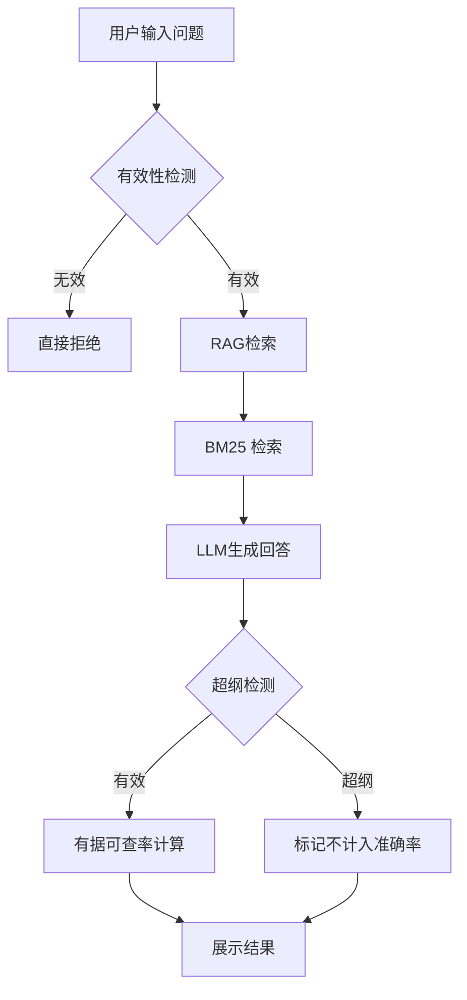

# SmartGuide AI - 智能硬件客服助手 🤖

[](https://www.python.org/downloads/)
[](https://streamlit.io)
[](LICENSE)

基于 RAG（检索增强生成）技术的智能客服系统，专注于智能硬件设备的使用问题解答。支持**智能手环**、**智能手表**、**智能音箱**、**智能台灯**、**智能门锁**五大类设备。

## 📚 文档导航

| 文档 | 定位 | 适合谁 |
|------|------|--------|
| [docs/PRD.md](docs/PRD.md) | 产品需求文档（用户画像、痛点、竞品、指标体系、决策权衡） | 面试前建立产品框架 |
| [PRODUCT.md](PRODUCT.md) | 产品经理深度解读（38 个产品知识点 + 面试题库） | 深入理解每个设计的产品理由 |
| [BACKEND.md](BACKEND.md) | 后端逐行代码解读（技术面试考点） | 技术追问答得上来 |

## ✨ 核心特性

### 🎯 三级问题分类系统
自动识别并处理不同类型的用户提问：
- **无效问题** - 不符合客服场景，直接拦截，不浪费 API 调用
- **超纲问题** - 涉及价格、保修、购买等知识库外内容，AI 礼貌拒答，不计入指标
- **有效问题** - 正常回答，计入指标统计与评测

### 📊 双指标：有据可查率 + 关键点召回率
两个指标分开看，避免把「抄了文档」当成「答对了」：
- **有据可查率（groundedness，原方案 A）**：答案关键词被检索文档覆盖的比例，衡量防幻觉能力；
- **关键点召回率（correctness）**：答案覆盖标准答案关键点的比例，衡量答得对不对；
- **任务成功率**：在可判分题目上，「答对 + 超纲题正确拒答」的比例。

### 🔄 真多轮对话
- 最近 `HISTORY_TURNS` 轮问答进入 prompt（默认 3 轮，可配置）；
- 参考文档只放当前轮，避免历史文档挤占上下文；
- 设备级上下文记忆保留：问过一次设备后可省略设备名。

### 🔎 可切换检索后端
- `bigram`：原始字面检索，零依赖；
- `bm25`：默认，中文 bigram 分词 + 标题加权，长文档更稳；
- `hybrid`：BM25 + 向量（bge-small-zh）+ RRF 融合，可选 CrossEncoder 重排；
- 向量依赖缺失时自动降级，不影响主流程。

### 📈 可复现评测
- 命令行 `python -m evaluation.run_eval` 或页面「一键评测」；
- 逐题结果（回答/检索数/两指标/耗时）自动落盘到 `evaluation/results/run_*/`；
- 支持关键词判分与 LLM judge 两种 correctness 口径。

### 🎯 埋点与自助解决率
- 每次问答写入 SQLite（`data/telemetry.db`），记录分类、有据可查率、检索数、耗时；
- 用户可点「👍 已解决 / 👎 未解决」；
- 会话内窗口期追问自动标记为 `follow_up`；
- 「自助解决率看板」按文档口径计算北极星指标。

### 🔄 智能 API 限流处理
遇到 429 限流错误时自动重试：
- 指数退避策略（3秒 → 6秒 → 9秒）
- 最多重试 3 次
- 无需人工干预，保证评测流程稳定运行

## 🛠️ 技术栈

| 技术 | 版本 | 用途 |
|------|------|------|
| Python | 3.10+ | 主开发语言 |
| Streamlit | 1.28+ | Web 界面框架 |
| OpenAI SDK | 1.0+ | LLM API 调用（兼容 DeepSeek / 通义 等 OpenAI 兼容服务） |
| Plotly | 5.17+ | 交互式数据可视化 |
| Pandas | 2.0+ | 数据处理与分析 |
| NumPy | 1.24+ | 数值计算 |

**检索方案**: 默认 BM25（纯 Python、零依赖）；可切 bigram 或 hybrid（BM25 + bge-small-zh 向量 + RRF，依赖 sentence-transformers）。不强制依赖 Chroma/FAISS。

## 🚀 快速开始

### 环境要求

- Python 3.10+ (推荐 3.12)
- pip 包管理器
- 稳定的网络连接（调用 LLM API）

### 安装步骤

#### 1️⃣ 克隆仓库

```bash
git clone git@github.com:xhygaaaaa/smart-ai.git
cd smart-ai
```

或使用 HTTPS：
```bash
git clone https://github.com/xhygaaaaa/smart-ai.git
cd smart-ai
```

#### 2️⃣ 安装依赖

**标准安装：**
```bash
pip install -r requirements.txt
```

**国内用户加速（推荐）：**
```bash
pip install -i https://mirrors.aliyun.com/pypi/simple/ -r requirements.txt
```

依赖清单（仅 6 个包，约 2-3 分钟安装完成）：
```
openai>=1.0.0
python-dotenv>=1.0.0
streamlit>=1.28.0
plotly>=5.17.0
pandas>=2.0.0
numpy>=1.24.0
```

⚠️ **说明**: 核心依赖不包含 `chromadb` / `sentence-transformers` / `torch`，默认 BM25 检索无需它们。
只有启用 `RETRIEVER=hybrid` 或 CrossEncoder 重排时，才需要：
```bash
pip install -r requirements-optional.txt
```
（Windows 上如遇 DLL 加载错误，说明本机 torch 版本不匹配，保持默认 `bm25` 即可。）

#### 3️⃣ 配置 API 密钥

复制环境变量模板：
```bash
cp .env.example .env
```

编辑 `.env` 文件，填入你的大模型 API 配置：

```env
LLM_BASE_URL=https://api.deepseek.com/v1
LLM_API_KEY=你的-api-key
LLM_MODEL=deepseek-chat
LLM_TEMPERATURE=0.3

# 检索：bigram / bm25 / hybrid
RETRIEVER=bm25
TOP_K=5

# 多轮对话带入的历史轮数（0=关闭）
HISTORY_TURNS=3
```

**API 申请地址：**
- [MiniMax](https://api.minimax.chat/) - 新用户有免费额度
- [通义千问](https://dashscope.aliyun.com/) - 阿里云
- [DeepSeek](https://platform.deepseek.com/) - 价格低廉
- [智谱 GLM](https://open.bigmodel.cn/) - 清华技术

**其他兼容 API 配置示例：**

<details>
<summary>通义千问</summary>

```env
LLM_BASE_URL=https://dashscope.aliyuncs.com/compatible-mode/v1
LLM_API_KEY=你的-通义-api-key
LLM_MODEL=qwen-turbo
LLM_TEMPERATURE=0.3
TOP_K=5
```
</details>

<details>
<summary>DeepSeek</summary>

```env
LLM_BASE_URL=https://api.deepseek.com
LLM_API_KEY=你的-deepseek-api-key
LLM_MODEL=deepseek-chat
LLM_TEMPERATURE=0.3
TOP_K=5
```
</details>

<details>
<summary>智谱 GLM</summary>

```env
LLM_BASE_URL=https://open.bigmodel.cn/api/paas/v4
LLM_API_KEY=你的-智谱-api-key
LLM_MODEL=glm-4
LLM_TEMPERATURE=0.3
TOP_K=5
```
</details>

#### 4️⃣ 启动应用

```bash
streamlit run 问答系统.py
```

成功启动后，浏览器会自动打开 `http://localhost:8501`

**命令行输出示例：**
```
You can now view your Streamlit app in your browser.

  Local URL: http://localhost:8501
  Network URL: http://192.168.1.100:8501
```

### 4️⃣ 运行评测与测试

```bash
# 全量 100 题（结果自动写入 evaluation/results/run_*/）
python -m evaluation.run_eval

# 冒烟 3 题
python -m evaluation.run_eval --limit 3 --sleep 0

# 用 LLM judge 判 correctness（更准、更慢、更贵）
python -m evaluation.run_eval --judge llm

# 单测
pip install -r requirements-dev.txt
python -m pytest -q
```

**自助解决率**：在页面里点击「👍 已解决 / 👎 未解决」，然后打开
`pages/自助解决率.py` 查看；数据落在 `data/telemetry.db`。

## 📁 项目结构

```
smartguide-ai/
│
├── 问答系统.py                    # 🏠 Streamlit 主页 - 问答交互界面
│
├── pages/                         # 📄 多页面应用
│   ├── 实时评测.py                # 📊 实时有据可查率统计与可视化
│   ├── 一键评测.py                # 🧪 批量运行100题测试集（双指标+落盘）
│   └── 自助解决率.py              # 🎯 北极星指标看板（埋点数据）
│
├── src/                           # 🧩 核心业务模块
│   ├── __init__.py
│   ├── simple_rag.py              # 🔍 原始 bigram 检索
│   ├── retrieval.py               # 🔎 BM25 / 向量混合 / rerank 可切换检索
│   ├── llm_client.py              # 🤖 LLM 调用封装（含429重试+多轮 messages）
│   ├── evaluator.py               # ✅ 三级分类 + groundedness + correctness
│   ├── evaluation_runner.py       # 📉 可复现评测（逐题执行/汇总/落盘）
│   ├── telemetry.py               # 📈 SQLite 埋点与自助解决率
│   └── admin_panel.py             # 🛠️ 服务端看板与知识库管理
│
├── evaluation/                    # 📊 测试集与评测结果
│   ├── test_set.csv               # 100 题标准测试集
│   ├── README.md                  # 题目分布、扩题原则、判分口径
│   ├── run_eval.py                # 命令行评测入口
│   └── results/                   # run_*/ 逐题结果、summary、meta
│
├── tests/                         # ✅ pytest 单测
│
├── data/                          # 📚 知识库（5份产品使用指南）
│   ├── smart_band_manual.txt      # 智能手环使用指南
│   ├── smart_watch_manual.txt     # 智能手表使用指南
│   ├── smart_speaker_manual.txt   # 智能音箱使用指南
│   ├── smart_lamp_manual.txt      # 智能台灯使用指南
│   ├── smart_lock_manual.txt      # 智能门锁使用指南
│   └── telemetry.db               # 运行时生成的埋点库
│
├── .streamlit/                    # ⚙️ Streamlit配置
│   └── config.toml                # 隐藏开发者菜单等配置
│
├── config.py                      # 🔧 项目全局配置
├── requirements.txt               # 📦 Python依赖清单
├── .env                           # 🔐 本地环境变量（不提交git）
├── .env.example                   # 📋 环境变量模板
├── .gitignore                     # 🚫 Git忽略规则
└── README.md                      # 📖 项目文档（本文件）
```

### 知识库内容

每份使用指南约 **135-228 行**（5 份合计约 1.1 万字，切成 159 个知识块），包含：
- 产品概述
- 基本操作（配对/开机/配网）
- 主要功能详解
- 技术规格（防水等级/续航/尺寸等）
- 常见问题排查（连接/充电/识别失败等）
- 注意事项

### 测试集分类

| 类别 | 英文标识 | 题目数 | 说明 |
|------|---------|--------|------|
| 连接 | connectivity | 12 | 配对、开机、配网等基础连接问题 |
| 功能 | functionality | 30 | 运动模式、表盘、音乐、调光等功能使用 |
| 规格 | specification | 18 | 防水等级、续航、色温范围等参数查询 |
| 故障 | troubleshooting | 30 | 无法充电、连接断开、闪烁等故障排查 |
| 超纲 | out_of_scope | 10 | 价格、保修、购买等知识库外问题 |
| **总计** | | **100** | 五类设备 × 五类问题，覆盖客服主要场景 |

> 扩集原则：题目全部来自 5 份设备手册，标准答案保留手册原词（便于 bigram 召回判分）；
> 超纲题的标准答案是明确拒答话术，保证「拒答」也能被判对。
> 划分了 `easy / medium / hard` 三档难度，可按难度切片看模型短板。

## 📖 使用指南

### 页面 1: 问答系统 🏠

智能客服的主交互界面。

**功能：**
1. 在底部输入框提问（如："智能手环如何连接手机？"），回车即发
2. 系统自动执行：
   - 有效性检测（第一级过滤）
   - 知识库检索（BM25 / 可选混合检索）
   - LLM 生成回答
   - 问题分类（无效/超纲/有效）
   - 有据可查率计算（groundedness）
3. 问过一次设备后，后续可省略设备名（"那怎么充电？"），顶部会提示当前记住的是哪台设备
4. 想重新开始一段对话，点右上角 🆕 **新对话**：清空聊天记录 + 上下文记忆 + 会话 ID，
   埋点里记为一次新会话（刷新页面做不到这点，刷新只会沿用旧 session_state）

**显示内容：**
- 💬 **AI 回答** - 生成的答案文本
- 📚 **资料出处** - 折叠展示检索到的段落和相似度
- 👍/👎 **已解决 / 未解决** - 用户反馈，喂给服务端的自助解决率看板

**示例问题：**
```
✅ 有效: "智能手表如何接听电话?"
✅ 有效: "智能门锁可以录入多少个指纹?"
✅ 有效: "智能音箱怎么重置?"
🟡 超纲: "智能手环的价格是多少?"
🔴 无效: "你好"
```

---

### 页面 2: 实时评测 📈

可视化展示准确率变化趋势，监控系统表现。

**功能：**
- 自动统计本次会话中所有 **有效问题** 的准确率
- 超纲和无效问题不计入统计
- 实时更新图表

**可视化内容：**
1. **总体统计面板**
   - 有效问题数
   - 平均准确率
   - 最高/最低准确率

2. **每次提问准确率柱状图**
   - 绿色(≥70%) / 橙色(50-70%) / 红色(<50%)
   - 显示每题的准确率数值

3. **准确率趋势折线图**
   - 追踪准确率变化
   - 红色虚线标记平均值

4. **详细记录表格**
   - 序号、问题、准确率、分类

**适用场景：**
- 调整 Prompt 后观察效果
- 对比不同模型的表现
- 发现系统弱点（低准确率的题目类型）

---

### 页面 3: 一键评测 🎯

批量运行标准测试集，全面验证系统性能。

**功能：**
- 点击 ▶️ **开始评测**，逐题运行 100 道标准测试题
- 评测跑在**独立后台进程**（`evaluation/bg_runner.py`）里：切到别的页面、刷新浏览器、关掉标签页都不会中断，回到本页自动接着显示进度
- 进度实时写盘（`evaluation/results/<run_id>/progress.json`），页面每 2 秒轮询一次
- 随时可以 ⏹ **停止评测**：当前题跑完后收尾，已跑完的结果保留并照常汇总

**评测报告内容：**
1. **核心指标**
   - 总问题数 / 有效问题数 / 超纲题数
   - 有据可查率（groundedness）：答案关键词被检索文档支撑的比例
   - 关键点召回率（correctness recall）：答案覆盖标准答案关键词的比例
   - 任务成功率：有效题答对 + 超纲题正确拒答
   - 错误数: API 调用失败的题目

2. **问题分类统计**
   - 有效 / 超纲 / 无效 数量分布
   - 验证三级分类是否正确工作

3. **有据可查率分布直方图**

4. **逐题明细表**
   - 每题的问题/分类/是否答对/是否拒答/耗时/错误信息
   - 可排序、可搜索

5. **导出 CSV**

**运行产物**（`evaluation/results/<run_id>/`）：
`progress.json`（进度快照）· `results.jsonl` / `results.csv` / `summary.json` / `meta.json` · `eval.log`（后台日志）

**适用场景：**
- Prompt 工程迭代验证
- 对比不同大模型/不同检索后端（bm25 / bigram / hybrid）
- 上线前回归测试
- 定期质量监控

**注意事项：**
- 100 题约 3-5 分钟（取决于 API 响应速度与「每题间隔」设置）
- 遇到 429 限流会自动重试；担心限流就把「每题间隔」调到 1-2 秒
- 也可以用命令行跑，效果与页面完全一致：
  ```bash
  python -m evaluation.bg_runner --judge keyword --retriever bm25 --sleep 0.5
  ```

## 🔬 核心技术详解

### 1. 三级问题分类系统

**设计目标**: 避免无效 API 调用，准确率统计更科学

#### 第一级：无效问题过滤

**代码位置**: `src/evaluator.py` - `is_valid_question()`

**判断逻辑**:
```python
def is_valid_question(self, question: str) -> bool:
    # 1. 长度检查
    if len(question.strip()) < 3:
        return False
    
    # 2. 设备关键词检查
    device_keywords = ["手环", "手表", "音箱", "台灯", "门锁", "智能"]
    has_device = any(kw in question for kw in device_keywords)
    
    # 3. 动作词检查
    action_keywords = ["如何", "怎么", "怎样", "什么", "多少", ...]
    has_action = any(kw in question for kw in action_keywords)
    
    return has_device or has_action
```

**拦截示例**:
- ❌ "你好" (过短)
- ❌ "今天天气如何" (无设备关键词)
- ❌ "哈哈哈" (无意义输入)

#### 第二级：超纲问题识别

**代码位置**: `src/evaluator.py` - `is_refusal()`

**判断逻辑**: 检测 AI 回答中是否包含拒答信号词
```python
REFUSAL_SIGNALS = [
    "不在", "无法", "不能", "没有收录", "不包含", "超出",
    "不提供", "无法作答", "不在手册", "不在指南", "建议咨询"
]

def is_refusal(self, answer: str) -> bool:
    return any(signal in answer for signal in self.refusal_signals)
```

**超纲示例**:
- "智能手环的价格是多少?" → AI 回答包含 "不在使用指南中"
- "智能门锁保修几年?" → AI 回答包含 "建议咨询售后"

**处理方式**: 不计入准确率统计（因为知识库本身不包含这类信息）

#### 第三级：有效问题

通过前两级过滤后，正常回答并计算准确率。

---

### 2. 方案A准确率算法

**设计理念**: 与标准答案对比的传统方法存在局限（标准答案可能不唯一），方案A专注于衡量 **防幻觉能力**。

**核心思想**: AI 回答的关键词应该在引用的原文档中能找到支撑，而不是凭空编造。

**代码位置**: `src/evaluator.py` - `calculate_accuracy_a()`

#### 算法流程

```python
def calculate_accuracy_a(self, answer: str, retrieved_docs: List) -> Tuple[float, dict]:
    # 1. 提取回答的关键词
    answer_keywords = self.extract_keywords_v2(answer)
    
    # 2. 合并所有检索文档的内容
    all_doc_content = " ".join([content for _, content, _ in retrieved_docs])
    doc_keywords = self.extract_keywords_v2(all_doc_content)
    
    # 3. 计算有多少回答关键词能在文档中找到
    supported = answer_keywords & doc_keywords
    unsupported = answer_keywords - doc_keywords
    
    # 4. 准确率 = 有支撑的关键词数 / 总关键词数
    accuracy = len(supported) / len(answer_keywords)
    
    return accuracy, {...详细信息...}
```

#### 示例说明

**用户问题**: "智能手环的续航是多少天?"

**检索到的文档**:
```
续航时间：典型使用约14天，重度使用约7天
```

**AI 回答**:
```
智能手环的续航时间为典型使用14天、重度使用7天。
```

**关键词提取**:
- 回答关键词: {`智能手环`, `续航`, `14天`, `7天`, `典型`, `重度`}
- 文档关键词: {`续航时间`, `典型使用`, `14天`, `重度使用`, `7天`}

**匹配结果**:
- ✅ 有支撑: `14天`, `7天`, `典型`, `重度`
- ❌ 无支撑: `智能手环` (文档中未明确出现这个词)

**准确率**: 4/6 = **66.7%**

**意义**: 如果准确率很低（如<50%），说明 AI 编造了大量文档中不存在的内容，存在幻觉风险。

---

### 3. 改进版关键词提取算法

**问题**: 简单的 2 字滑窗会提取出大量垃圾词（如 "约天"、"ma"、"的是"）

**代码位置**: `src/evaluator.py` - `extract_keywords_v2()`

#### 三步提取策略

**Step 1: 正则提取"数字+单位"组合**
```python
number_patterns = [
    r'\d+[天日小时分钟秒]',  # 时间: 7天、2小时
    r'\d+ATM',               # 防水等级: 5ATM
    r'\d+米',                 # 距离: 5米
    r'\d+[KkMm]',            # 色温/存储: 2700K
    r'\d+%',                 # 百分比: 50%
    r'\d+-\d+[KkMm位]',      # 范围: 2700-6500K
    r'\d+枚',                # 指纹数: 100枚
    r'\d+\.?\d*秒',          # 小数秒: 0.3秒
]
```

**Step 2: 移除连接词和语气词**
```python
filler_words = ['的', '了', '是', '在', '和', '与', '或', 
                '即可', '可以', '需要', '然后', '接着', '约', '大约']
```

**Step 3: 提取 2-5 字中文短语**
```python
phrases = re.findall(r'[一-龥]{2,5}', clean_text)
# 过滤停用词
stopwords = {'然后', '接着', '如果', '这个', '那个', '进行', '开始'}
meaningful_phrases = [p for p in phrases if p not in stopwords]
```

#### 提取效果对比

| 输入文本 | 粗暴2字滑窗 | 改进算法 |
|---------|------------|---------|
| "续航约14天" | 续, 航, 约, 14, 4天 | **14天** |
| "防水5ATM" | 防, 水, 5A, AT, TM | **5ATM** |
| "2700K暖光" | 27, 70, 00, 0K, K暖, 暖光 | **2700K**, **暖光** |

---

### 4. API 限流重试机制

**问题**: 大模型服务商通常有 RPM（每分钟请求数）限制，一键评测时容易触发 429 错误。

**代码位置**: `src/llm_client.py` - `_call_api_with_retry()`

#### 指数退避策略

```python
def _call_api_with_retry(self, messages: list, max_retries: int = 3) -> str:
    for attempt in range(max_retries):
        try:
            response = self.client.chat.completions.create(...)
            return response.choices[0].message.content
        
        except Exception as e:
            # 检测429限流错误
            if "429" in str(e) or "rate" in str(e).lower():
                if attempt < max_retries - 1:
                    wait_time = (attempt + 1) * 3  # 3秒、6秒、9秒
                    print(f"遇到限流，等待{wait_time}秒后重试...")
                    time.sleep(wait_time)
                    continue
            raise e
    
    raise Exception("API调用失败，已达最大重试次数")
```

**重试时间**:
- 第 1 次失败: 等待 3 秒
- 第 2 次失败: 等待 6 秒
- 第 3 次失败: 等待 9 秒
- 仍失败: 抛出异常

**效果**: 一键评测 100 题时，即使 API 限流也能自动恢复，无需人工干预。

---

### 5. Streamlit 状态管理

**问题**: Streamlit 采用全脚本重跑模式，每次交互都会重新执行整个脚本，导致临时变量丢失。

**解决方案**: 使用 `st.session_state` 持久化存储

**代码位置**: `问答系统.py`

```python
# 初始化
if 'current_result' not in st.session_state:
    st.session_state.current_result = None

# 存储结果
st.session_state.current_result = {
    "question": question,
    "answer": answer,
    "accuracy": accuracy,
    ...
}

# 显示结果（从 session_state 读取）
if st.session_state.current_result:
    result = st.session_state.current_result
    st.info(result["answer"])
```

**避免的 Bug**: 
- ❌ 用户截图时按键盘，答案消失
- ❌ 切换到其他页面后返回，之前的结果不见了
- ✅ 现在结果始终保留在会话中

## ❓ 常见问题 (FAQ)

### 安装与环境

<details>
<summary><b>Q: 安装依赖时报 DLL 加载失败</b></summary>

**症状**:
```
OSError: [WinError 1114] 动态链接库(DLL)初始化例程失败
```

**原因**: 误装了 `chromadb` 或 `sentence-transformers`，这些包依赖 PyTorch，在某些 Windows 环境下会出现 DLL 加载问题。

**解决**:
```bash
# 卸载重量级包
pip uninstall -y torch sentence-transformers chromadb

# 只安装 requirements.txt 中的 6 个轻量依赖
pip install -r requirements.txt
```

默认的 BM25 检索是纯 Python 实现，**不需要向量数据库和 Torch**；只有把 `RETRIEVER` 切成 `hybrid` 才需要 `sentence-transformers`。
</details>

<details>
<summary><b>Q: 中文输出乱码</b></summary>

**症状**: 终端打印中文显示 "涓嶈兘鎻愪緵" 等乱码

**原因**: Windows 控制台默认 GBK 编码，Python 输出 UTF-8 冲突

**解决**: 
1. **推荐**: Streamlit 网页端显示正常，无需处理
2. **如需命令行输出**: 在脚本开头添加

```python
import sys, io
if sys.platform == 'win32':
    sys.stdout = io.TextIOWrapper(sys.stdout.buffer, encoding='utf-8')
```
</details>

<details>
<summary><b>Q: Python 版本要求</b></summary>

**最低**: Python 3.10  
**推荐**: Python 3.12  
**不支持**: Python 3.9 及以下（部分依赖需要 3.10+）

查看当前版本:
```bash
python --version
```
</details>

---

### API 调用

<details>
<summary><b>Q: API 限流 429 错误</b></summary>

**症状**: 一键评测时多次报 `rate limit exceeded (RPM)`

**原因**: 大模型服务商通常有每分钟请求数（RPM）限制

**已实现的自动处理**: 代码中已集成指数退避重试（3/6/9秒）

**如仍频繁超限**: 增加请求间隔

```python
# 编辑 pages/一键评测.py 第 86 行
time.sleep(2)  # 原来是 1 秒，改成 2 或 3 秒
```
</details>

<details>
<summary><b>Q: 换成其他大模型</b></summary>

只需修改 `.env` 文件，无需改代码。任何兼容 OpenAI 格式的 API 都支持。

**通义千问**:
```env
LLM_BASE_URL=https://dashscope.aliyuncs.com/compatible-mode/v1
LLM_API_KEY=sk-xxx
LLM_MODEL=qwen-turbo
```

**DeepSeek**:
```env
LLM_BASE_URL=https://api.deepseek.com
LLM_API_KEY=sk-xxx
LLM_MODEL=deepseek-chat
```

**本地模型（Ollama）**:
```env
LLM_BASE_URL=http://localhost:11434/v1
LLM_API_KEY=ollama  # 随便填
LLM_MODEL=qwen:7b
```
</details>

<details>
<summary><b>Q: API Key 安全问题</b></summary>

**不要**: 把 `.env` 文件提交到 git

**已做的防护**:
- `.gitignore` 中已添加 `.env`
- 提供 `.env.example` 作为模板
- `.env` 只存本地，不会被推送到 GitHub

**泄露后**: 立即在 API 服务商后台删除该 Key 并重新生成
</details>

---

### 使用问题

<details>
<summary><b>Q: 答案截图后消失</b></summary>

**原因**: Streamlit 全脚本重跑模式下，未持久化的变量会丢失

**解决**: 已通过 `st.session_state` 持久化存储，正常使用不会出现此问题

如仍出现，检查是否修改了代码中的 session_state 逻辑
</details>

<details>
<summary><b>Q: 切到别的页面，评测会不会中断？</b></summary>

**不会。** 评测跑在独立子进程里（`evaluation/bg_runner.py`），页面只是个「监视器」：
切页面 / 刷新 / 关标签页都不影响后台进程，进度每 2 秒写一次磁盘。

回到「一键评测」页会自动接上：
1. 先读 `st.session_state.eval_run_id`
2. 没有再读指针文件 `evaluation/results/.current_run`
3. 都没有就取最新修改过 `progress.json` 的运行目录

**设计说明**: 用 `subprocess.Popen` 拉起独立进程 + 落盘进度，
而不是在 Streamlit 脚本里跑循环 —— 后者一导航就会重跑脚本、把评测打断。
中途不想跑了就点 ⏹ **停止评测**（写 `STOP` 标记文件，当前题跑完即收尾），
已跑完的题目照常汇总。
</details>

<details>
<summary><b>Q: 准确率为什么不是100%？</b></summary>

**有据可查率衡量的是防幻觉能力，不是答案完全正确性。**

举例:
```
问题: "智能手环续航多少天?"
文档: "续航典型14天"
AI回答: "智能手环的续航时间大约为14天左右"
```

关键词:
- ✅ 有支撑: "14天"
- ❌ 无支撑: "大约", "左右" (文档中未出现)

准确率可能是 **60-80%**，但答案本身是正确的。

**低准确率警示**: 如果 <50%，说明 AI 编造了大量文档中不存在的信息。
</details>

---

### 开发定制

<details>
<summary><b>Q: 如何添加新的设备类型？</b></summary>

**Step 1**: 创建使用指南文件

```bash
# 在 data/ 目录下创建新文件
data/smart_camera_manual.txt
```

**Step 2**: 修改配置

编辑 `config.py`:
```python
MANUALS = {
    "智能手环": os.path.join(DATA_DIR, "smart_band_manual.txt"),
    # ... 其他设备 ...
    "智能摄像头": os.path.join(DATA_DIR, "smart_camera_manual.txt"),  # 新增
}
```

**Step 3**: 添加测试题

在 `evaluation/test_set.csv` 中添加相关问题。

**Step 4**: 重启应用
```bash
streamlit run 问答系统.py
```
</details>

<details>
<summary><b>Q: 如何调整准确率算法？</b></summary>

编辑 `src/evaluator.py` 中的 `calculate_accuracy_a` 方法。

**示例：改为更严格的算法**
```python
# 原：准确率 = 有支撑词数 / 总词数
accuracy = len(supported) / len(answer_keywords)

# 改：只有支撑率≥80%才算通过
if len(answer_keywords) > 0:
    support_rate = len(supported) / len(answer_keywords)
    accuracy = 1.0 if support_rate >= 0.8 else 0.0
```
</details>

<details>
<summary><b>Q: 如何增加检索的文档数量？</b></summary>

编辑 `.env` 文件:
```env
TOP_K=5  # 原来是 3，改为 5
```

检索更多文档可能提高准确率，但也会：
- 增加 Token 消耗
- 增加响应时间
- 可能引入噪声

建议通过实验找到最优值（通常 3-5 之间）。
</details>

---

### 性能与限制

<details>
<summary><b>Q: 一键评测需要多久？</b></summary>

**时间估算**: 3-6 分钟（100 题）

**实测**: DeepSeek + bm25 + 每题间隔 0.3 秒，100 题 **2 分 11 秒**跑完

**影响因素**:
- API 响应速度与网络延迟
- 「每题间隔」设置（限流严重就调大）
- 是否触发 429 重试

**加速方法**: 降低「每题间隔」，或把检索深度 `TOP_K` 调小（可能影响准确率）
</details>

<details>
<summary><b>Q: 能处理多大的知识库？</b></summary>

**当前规模**: 5 份文档、约 1.1 万字、159 个知识块

**理论上限**: 
- BM25 索引可处理 **百万行级别** 文档
- 瓶颈在 LLM 上下文长度（通常 4K-32K tokens）

**扩展建议**:
- 单份文档 < 10KB
- 总文档数 < 50 份
- 超出后考虑分层检索或向量数据库
</details>

<details>
<summary><b>Q: 能不能离线运行？</b></summary>

**RAG 检索部分**: ✅ 完全离线（默认 BM25，纯 Python 实现）

**LLM 生成部分**: 
- ❌ 在线 API（DeepSeek/通义 等）需要网络
- ✅ 本地模型（Ollama/LM Studio）可离线，配置示例：

```env
LLM_BASE_URL=http://localhost:11434/v1
LLM_API_KEY=ollama
LLM_MODEL=qwen:7b
```
</details>

---

### 故障排查

<details>
<summary><b>Q: 启动时端口占用</b></summary>

**症状**: `OSError: [Errno 48] Address already in use`

**原因**: 8501 端口已被占用

**解决**: 指定其他端口
```bash
streamlit run 问答系统.py --server.port 8502
```
</details>

<details>
<summary><b>Q: 页面空白/无法加载</b></summary>

**排查步骤**:
1. 检查终端是否有报错
2. 确认依赖已全部安装: `pip list | grep streamlit`
3. 清除缓存重启: `streamlit cache clear`
4. 检查 `.env` 文件是否存在且格式正确
</details>

## 🛠️ 开发指南

### 技术架构



### 代码规范

**文件命名**:
- 模块文件: `snake_case.py`
- 页面文件: 中文命名（Streamlit多页面约定）

**函数命名**:
- 公开方法: `snake_case`
- 私有方法: `_snake_case`

**注释规范**:
```python
def calculate_accuracy_a(self, answer: str, docs: List) -> Tuple[float, dict]:
    """
    有据可查率（groundedness）计算
    
    Args:
        answer: AI生成的回答
        docs: 检索到的文档列表 [(设备名, 内容, 得分), ...]
    
    Returns:
        (准确率, 详细信息字典)
    """
```

### 扩展开发

#### 添加新的准确率算法

创建 `src/evaluator.py` 中的新方法:

```python
def calculate_accuracy_b(self, answer: str, expected: str) -> float:
    """
    方案B: 与标准答案的BLEU相似度
    """
    # 实现 BLEU 算法
    pass

# 在问答系统.py中调用
accuracy_a, _ = evaluator.calculate_accuracy_a(answer, docs)
accuracy_b = evaluator.calculate_accuracy_b(answer, expected_answer)
```

#### 集成向量数据库

如需处理更大规模知识库，可替换 `simple_rag.py`:

```python
# 安装依赖
pip install chromadb sentence-transformers

# 修改 src/simple_rag.py
from chromadb import Client
from sentence_transformers import SentenceTransformer

class VectorRAG:
    def __init__(self, documents: dict):
        self.client = Client()
        self.collection = self.client.create_collection("manuals")
        self.encoder = SentenceTransformer('all-MiniLM-L6-v2')
        self._build_index(documents)
    
    def retrieve(self, query: str, top_k: int) -> List:
        query_vec = self.encoder.encode(query)
        results = self.collection.query(
            query_embeddings=[query_vec],
            n_results=top_k
        )
        return results
```

**注意**: Windows 环境下向量数据库可能遇到 DLL 问题，建议 Linux/Mac 或 Docker 部署。

#### 添加语音交互

集成 Whisper（语音识别）+ TTS（语音合成）:

```python
# 安装依赖
pip install openai-whisper pyttsx3

# 在问答系统.py中添加
import whisper
import pyttsx3

# 语音输入
model = whisper.load_model("base")
audio_file = st.file_uploader("上传语音问题", type=['wav', 'mp3'])
if audio_file:
    result = model.transcribe(audio_file)
    question = result["text"]

# 语音输出
engine = pyttsx3.init()
engine.say(answer)
engine.runAndWait()
```

---

## 📊 性能基准

### 评测环境

- CPU: Intel i5-12400
- RAM: 16GB
- 网络: 100Mbps 家庭宽带
- LLM: DeepSeek deepseek-chat（temperature=0.3）
- 测试集: 100题标准集

### 性能指标

| 指标 | 数值 |
|------|------|
| 平均响应时间 | 1.14 秒/题（中位 1.13 秒，最慢 2.34 秒） |
| 检索时间 | <100ms |
| LLM调用时间 | 0.6-2.3 秒 |
| 准确率计算 | <50ms |
| 一键评测总时长 | 约 2 分 11 秒（100 题，DeepSeek，每题间隔 0.3 秒） |
| 内存占用 | 约150MB |

### 评测表现（可复现）

最近一次全量运行：`python -m evaluation.bg_runner --judge keyword --retriever bm25 --sleep 0.3`
（2026-10-26，`deepseek-chat`，temperature=0.3，BM25，TOP_K=5，**100 题**）：

| 指标 | 数值 | 说明 |
|------|------|------|
| 总题数 | 100 | 含 10 道超纲题 |
| 有效题 | 90 | 超纲题不计入 groundedness/correctness |
| 有据可查率（groundedness） | **60.7%** | 答案关键词被检索文档覆盖的比例 |
| 关键点召回率（correctness） | **71.1%** | 答案覆盖标准答案 bigram 的比例 |
| 答对率（correctness ≥ 0.6） | **75.6%** | 90 道有效题中 68 道达到阈值 |
| 超纲拒答率 | **100%** | 10 道超纲题全部正确拒答 |
| 任务成功率 | **78.0%** | （答对 68 + 正确拒答 10）/ 100 |

结果目录：`evaluation/results/run_100_v3/`，包含
`progress.json`（进度）、`results.jsonl`（逐题回答/检索数/两指标/耗时）、
`results.csv`、`summary.json`、`meta.json`、`eval.log`。

> 扩到 100 题后 correctness 从 62.9% 升到 70.3%，是因为新增题更贴近手册原文；
> groundedness 从 65.1% 降到 60.5%，说明部分手册外扩写（同义解释）仍会被判为“无依据”——
> 这正是该指标要暴露的问题，不应只看单一数字。旧 41 题基线仍保留在
> `evaluation/results/run_20261026_143313/`，两套结果可对比。
>
> v3 相对 v1 有两处代码/知识库改动：知识库补「如何重置」章节 + `QUERY_SYNONYMS` 同义桥接；
> 修掉拒答误判（模型先答正文、末尾补一句“无法作答”时，整题曾被判成超纲并从统计里剔除）。
> 但 73.3% → 75.6% 这 2 道题**不是**这两处改动带来的：temperature=0.3 下模型输出本身有波动，
> 这次是「手环怎么连手机」和「音箱支持 5GHz WiFi 吗」刚好跨过 0.6 阈值。
> 这批数字整体波动在 ±2 题以内，引用时请当作区间而非精确值。

**说明**:
- 评测是**可复现的**：模型、温度、检索后端、TOP_K 都写入 `meta.json`；
  换模型或温度后数字会变，属正常现象。
- 历史文档里曾记录的 74.2% 是早期 groundedness 单次结果，已由本表替代，
  不再作为口径。
- groundedness 高只说明「回答能在文档里找到依据」，不等于结论正确；
  correctness 也只衡量关键点覆盖，不等于人工判定。两者需分开陈述。

---

## 🤝 贡献指南

欢迎提交 Issue 和 Pull Request！

### 提交 Bug

使用 GitHub Issues，包含以下信息:
- 操作系统和 Python 版本
- 完整的错误堆栈
- 复现步骤
- 预期行为 vs 实际行为

### 提交 Feature

1. Fork 本仓库
2. 创建特性分支 (`git checkout -b feature/AmazingFeature`)
3. 提交更改 (`git commit -m 'Add some AmazingFeature'`)
4. 推送到分支 (`git push origin feature/AmazingFeature`)
5. 提交 Pull Request

### 代码审查标准

- ✅ 通过现有测试集验证
- ✅ 添加必要的单元测试
- ✅ 更新相关文档
- ✅ 遵循现有代码规范
- ✅ 提供清晰的 commit message

---

## 📄 许可证

本项目基于 **MIT License** 开源。

```
MIT License

Copyright (c) 2024 SmartGuide AI Contributors

Permission is hereby granted, free of charge, to any person obtaining a copy
of this software and associated documentation files (the "Software"), to deal
in the Software without restriction, including without limitation the rights
to use, copy, modify, merge, publish, distribute, sublicense, and/or sell
copies of the Software, and to permit persons to whom the Software is
furnished to do so, subject to the following conditions:

The above copyright notice and this permission notice shall be included in all
copies or substantial portions of the Software.

THE SOFTWARE IS PROVIDED "AS IS", WITHOUT WARRANTY OF ANY KIND, EXPRESS OR
IMPLIED, INCLUDING BUT NOT LIMITED TO THE WARRANTIES OF MERCHANTABILITY,
FITNESS FOR A PARTICULAR PURPOSE AND NONINFRINGEMENT. IN NO EVENT SHALL THE
AUTHORS OR COPYRIGHT HOLDERS BE LIABLE FOR ANY CLAIM, DAMAGES OR OTHER
LIABILITY, WHETHER IN AN ACTION OF CONTRACT, TORT OR OTHERWISE, ARISING FROM,
OUT OF OR IN CONNECTION WITH THE SOFTWARE OR THE USE OR OTHER DEALINGS IN THE
SOFTWARE.
```

---

## 🙏 致谢

- **Streamlit** - 提供优雅的 Web 界面框架
- **OpenAI SDK** - 统一的 LLM API 调用接口
- **Plotly** - 强大的交互式可视化库
- **MiniMax/通义/DeepSeek** - 提供高质量的大模型服务

---

## 📞 联系方式

- GitHub Issues: [https://github.com/xhygaaaaa/smart-ai/issues](https://github.com/xhygaaaaa/smart-ai/issues)
- Email: 项目相关问题请优先使用 Issues

---

## 📚 相关资源

- [Streamlit 官方文档](https://docs.streamlit.io)
- [OpenAI API 文档](https://platform.openai.com/docs)
- [MiniMax API 文档](https://api.minimax.chat/document)
- [RAG 技术介绍](https://www.pinecone.io/learn/retrieval-augmented-generation/)

---

## 🎯 路线图

### v1.1 (已完成)
- [x] 支持多轮对话上下文（history 进 prompt）
- [x] 添加用户反馈收集与自助解决率埋点
- [x] 评测结果逐题落盘、可复现
- [x] BM25 / 向量混合检索可切换
- [ ] 导出 PDF 评测报告
- [ ] Docker 一键部署

### v2.0 (未来)
- [ ] 向量数据库持久化（当前向量为内存索引）
- [ ] 图文混合检索
- [ ] 多租户权限管理
- [ ] RESTful API 服务

---

<div align="center">

**⭐ 如果这个项目对你有帮助，请给一个 Star ⭐**

Made with ❤️ by Claude Opus 4.8

</div>